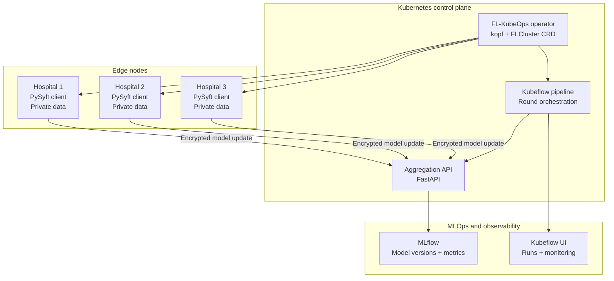

# FL-KubeOps

### Privacy-preserving federated learning, orchestrated with Kubernetes

Train collaboratively across distributed nodes while keeping each site's data local.

**[Operator](https://github.com/fl-kubeops/operator)** · **[FL Clients](https://github.com/fl-kubeops/fl-clients)** · **[Pipeline](https://github.com/fl-kubeops/pipeline)** · **[Docs](https://github.com/fl-kubeops/docs)**

---

## What is FL-KubeOps?

FL-KubeOps is a Kubernetes-native platform for running federated learning rounds across distributed nodes. Each node trains on its own private data and sends model updates rather than raw records.

The project combines a custom Kubernetes operator, federated-learning clients, and a Kubeflow pipeline so that a training round can be defined, scheduled, monitored, and reproduced as infrastructure.

## Architecture

**Data stays at the edge.** Only protected model updates move through the orchestration layer.

## Training round at a glance

| Step | What happens |
| --- | --- |
| **1. Define** | An `FLCluster` manifest describes the federated deployment. |
| **2. Reconcile** | The operator creates and monitors the required client workloads. |
| **3. Train locally** | Each client trains against its node's private dataset. |
| **4. Aggregate** | The pipeline coordinates encrypted updates and aggregation. |
| **5. Track** | MLflow records model versions, metrics, and round history. |

## Repositories

| Repository | Purpose | Status |
| --- | --- | --- |
| [operator](https://github.com/fl-kubeops/operator) | Python/kopf Kubernetes operator, `FLCluster` lifecycle, and recovery | Active development |
| [fl-clients](https://github.com/fl-kubeops/fl-clients) | PySyft clients for local training and secure model updates | Active development |
| [pipeline](https://github.com/fl-kubeops/pipeline) | Kubeflow Pipelines definitions and aggregation API integration | Active development |
| [docs](https://github.com/fl-kubeops/docs) | Public project documentation and specifications | Public |

## Technology stack

| Layer | Technology | Role |
| --- | --- | --- |
| Orchestration | Python, [kopf](https://kopf.readthedocs.io/), Kubernetes | Declarative FL lifecycle management |
| Federated learning | [PySyft](https://github.com/OpenMined/PySyft), PyTorch | Local training and protected updates |
| Workflow | [Kubeflow Pipelines](https://www.kubeflow.org/docs/components/pipelines/) | Reproducible training-round DAGs |
| Aggregation | [FastAPI](https://fastapi.tiangolo.com/) | Model-update collection API |
| Tracking | [MLflow](https://mlflow.org/) | Experiment tracking and model versioning |
| Runtime | [K3s](https://k3s.io/), Docker | Lightweight Kubernetes infrastructure |

## Project team

| Name | Focus |
| --- | --- |
| Faisal Khalid | Project lead and operator |
| Shah Wali | FL clients and aggregation |
| Wajeeh ur Rehman | Pipeline and infrastructure |
| M. Hammad | Testing and simulation |

**Institution:** University of Central Punjab · BSCS Final Year Project · Spring 2026  
**Advisor:** Prof. Dr. Saira Andleeb Gilani

## Learn more

Start with the [documentation repository](https://github.com/fl-kubeops/docs), or explore the [operator README](https://github.com/fl-kubeops/operator#readme) for the implementation entry point.

*An academic open-source project built to make federated learning infrastructure reproducible and extensible.*

